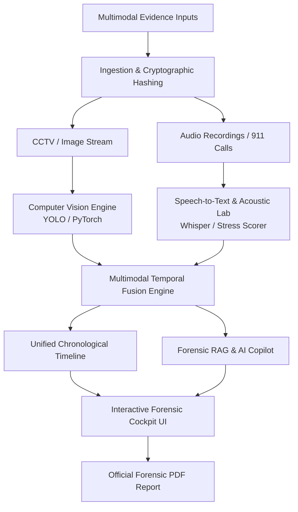

# CrimeVision AI – Intelligent Multimodal Forensic Analysis Platform

[](https://opensource.org/licenses/MIT)
[](https://www.python.org/)
[]()

> **CrimeVision AI** is an advanced forensic intelligence system engineered to automate crime scene reconstruction and digital evidence analysis using multimodal artificial intelligence. By integrating surveillance video, high-resolution imagery, and witness audio recordings, the platform reconstructs chronological crime timelines, identifies weapon threats, cross-corroborates testimony against camera feeds, and empowers investigators with a persistent AI-powered forensic query assistant.

---

## 🏛️ Project Epics & Tasks Breakdown (9 Epics | 16 Tasks)

| Epic # | Epic Name | Task Breakdown | Status |
|---|---|---|---|
| **Epic 1** | **Forensic Workspace & Case Docket** | **Task 1.1**: Docket Management<br>**Task 1.2**: Evidence Chain of Custody & Hashing | ✅ Completed |
| **Epic 2** | **Multimodal Evidence Ingestion** | **Task 2.1**: Multi-format Video/Image Upload<br>**Task 2.2**: Audio Stream Preprocessing | ✅ Completed |
| **Epic 3** | **Computer Vision & Threat Engine** | **Task 3.1**: Person & Biometric Profile Detection<br>**Task 3.2**: Weapon & Tool Identification | ✅ Completed |
| **Epic 4** | **Audio Forensics & Witness Transcription** | **Task 4.1**: Speech-to-Text & Diarization<br>**Task 4.2**: Acoustic Stress & Threat Scoring | ✅ Completed |
| **Epic 5** | **Named Entity Recognition & NLP** | **Task 5.1**: Forensic NER (Location, Weapon, Attire)<br>**Task 5.2**: Speech Intent Extraction | ✅ Completed |
| **Epic 6** | **Multimodal Cross-Temporal Fusion** | **Task 6.1**: Video/Audio Timestamp Synchronization<br>**Task 6.2**: Witness vs Camera Corroboration Matrix | ✅ Completed |
| **Epic 7** | **Interactive Chronological Timeline** | **Task 7.1**: Temporal Scrubber & Event Sequencer<br>**Task 7.2**: Interactive Media Jump Points | ✅ Completed |
| **Epic 8** | **Investigator AI Chat (RAG)** | **Task 8.1**: Evidence-grounded Natural Language Query<br>**Task 8.2**: Cryptographic Evidence Citations | ✅ Completed |
| **Epic 9** | **Court-Admissible Reporting Engine** | **Task 9.1**: Official Forensic Summary Generation<br>**Task 9.2**: High-Performance PDF/Print Exporter | ✅ Completed |

---

## 🔬 System Architecture



### Key Components:
1. **Computer Vision & Object Detection Engine (`models/object_detector.py`)**:
   - Detects persons, weapons (firearms, pry bars), burglary tools, vehicles, and license plates.
   - Calculates bounding boxes `[ymin, xmin, ymax, xmax]`, confidence percentages, and threat ratings (`CRITICAL`, `HIGH`, `MEDIUM`).
2. **Audio Forensics & Transcript Sync (`models/audio_analyzer.py`)**:
   - Transcribes audio with timestamped word intervals.
   - Computes vocal acoustic stress and extracts named forensic entities (Locations, Directions, Attire).
3. **Cross-Modal Correlation Engine (`models/timeline_fusion.py`)**:
   - Cross-references witness testimony with CCTV footage (e.g., verifying if the suspect's attire matches witness statements).
4. **Forensic RAG Chat Assistant (`models/forensic_rag.py`)**:
   - Natural language investigation interface citing exact evidence item IDs and timestamps.
5. **Reporting Engine (`models/report_generator.py`)**:
   - Compiles court-admissible forensic documentation meeting Federal Rules of Evidence (FRE) Rule 901 integrity requirements.

---

## 💻 System Requirements

### Hardware Requirements
- **Processor**: Intel Core i5 (8th Gen or above) / AMD Ryzen 5 or equivalent
- **RAM**: Minimum 8 GB (Recommended: 16 GB for concurrent neural inference)
- **Storage**: Minimum 256 GB SSD (500 MB for platform deployment)
- **Network**: Stable broadband connection (10 Mbps minimum)

### Software Requirements
- **Operating System**: Windows 10/11, macOS (Monterey or later), or Linux (Ubuntu 20.04+)
- **Python**: Version 3.8 or above (Fully compatible with Python 3.14)
- **Web Browser**: Google Chrome, Mozilla Firefox, or Microsoft Edge

---

## 🚀 Installation & Quick Start

### 1. Clone or Open the Workspace
```bash
cd C:\Users\ASUS\.gemini\antigravity-ide\scratch\crimevision-ai
```

### 2. Install Dependencies
```bash
pip install -r requirements.txt
```

### 3. Run the Platform
```bash
python run_server.py
```
*Or directly via Flask:*
```bash
python app.py
```

### 4. Access the Forensic Cockpit
Open your web browser and navigate to:
```
http://127.0.0.1:5000
```

---

## 📸 Key Features Showcase

### 1. High-Tech Forensic HUD & Bounding Box Overlays
- Real-time canvas overlay rendering detected suspect trajectories, weapons, and license plates.
- Interactive filter modes: **Standard Vision**, **High-Contrast Edge Extraction**, and **Thermal / Night Vision**.

### 2. Audio Forensics & Real-Time Waveform Sync
- Visual audio frequency oscillogram powered by HTML5 `<canvas>`.
- Real-time karaoke-style transcript tracking synchronized with acoustic stress variance gauges.

### 3. Chronological Crime Scene Reconstruction
- Temporal scrubber synchronizing CCTV frames, 911 dispatch calls, and physical evidence discovery in an unbroken chronological sequence.

### 4. Investigator AI Chat Copilot
- Context-aware natural language assistant with clickable evidence pills that immediately switch and zoom into the cited evidence item.

### 5. Official PDF Forensic Report
- One-click export of an official forensic case record complete with executive summary, chain of custody logs, evidence SHA-256 hashes, and investigator sign-off block.

---

## 🛡️ Chain of Custody & Compliance
CrimeVision AI automatically computes cryptographic **SHA-256 hashes** for all ingested media files and logs every examiner interaction with tamper-evident audit trails compliant with **FRE Rule 901 (Requirement of Authentication or Identification)**.
